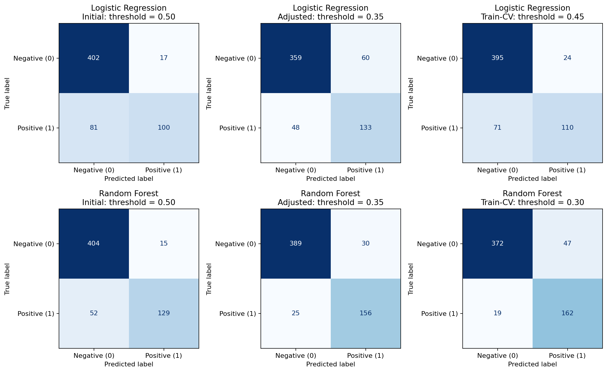
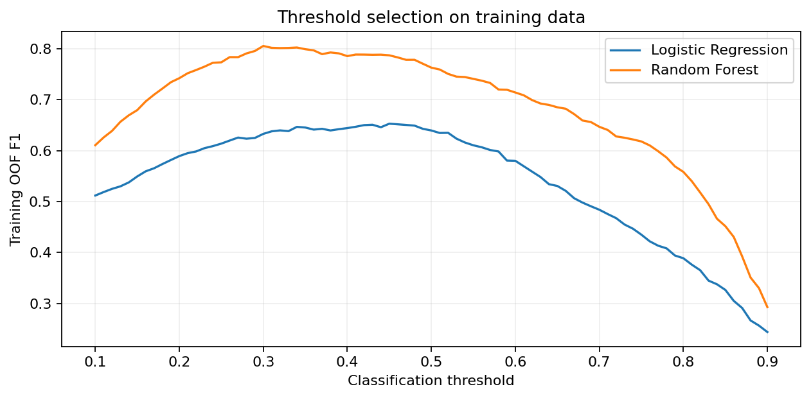
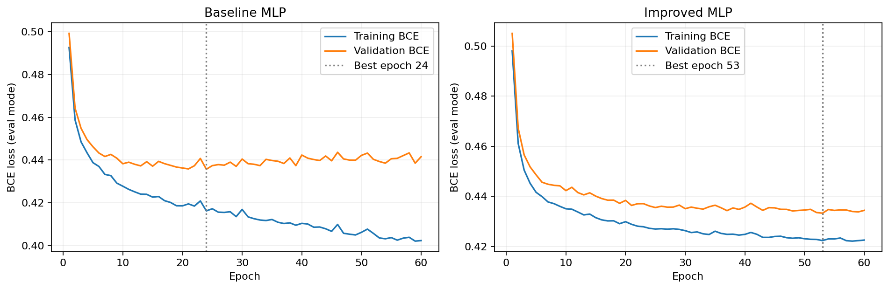
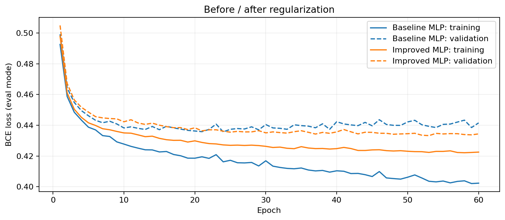
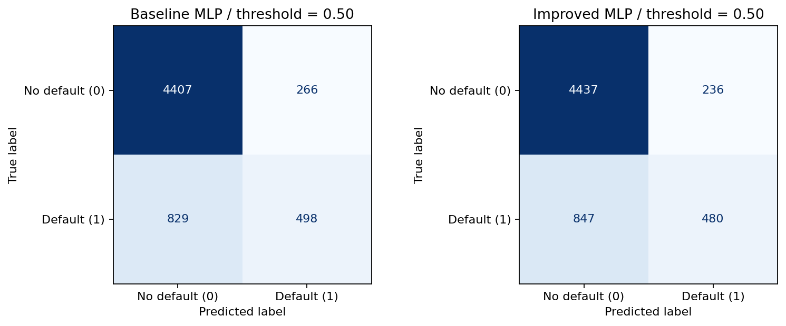
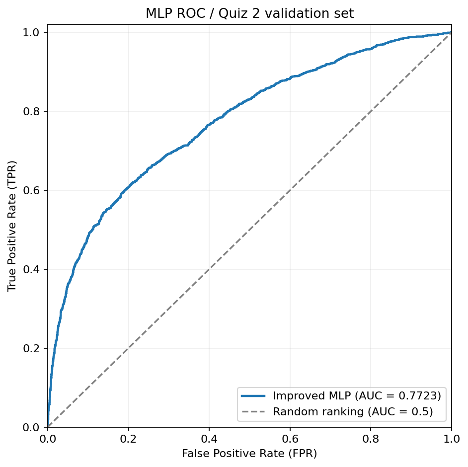
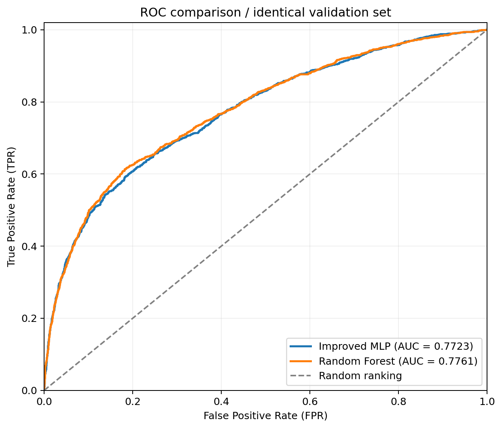

# HW2 實驗報告

三題皆包含講義的基礎與進階要求。下列數字為 2026-09-30 在 Python 3.12、CPU 執行得到的結果；對應 Notebook 已保存逐 cell 輸出。

## 1. Quiz 1：機器學習分類、門檻與混淆矩陣

資料是 `make_classification` 產生的 3,000 筆二元分類樣本，有 8 個特徵，seed=42。訓練 2,400 筆、驗證 600 筆。
特徵先乘不同尺度，再由模型 Pipeline 的 StandardScaler 只根據訓練資料估計縮放統計量。
Logistic Regression 與 Random Forest 皆使用同一批驗證樣本。

門檻 0.50 為原始設定，0.35 為明確的微調設定。第三個門檻以訓練集三折 out-of-fold F1 搜尋選定，沒有用驗證標籤挑選。

| Model | Setting | Threshold | Accuracy | Precision | Recall | F1 | TN | FP | FN | TP |
| --- | --- | --- | --- | --- | --- | --- | --- | --- | --- | --- |
| Logistic Regression | Initial | 0.5000 | 0.8367 | 0.8547 | 0.5525 | 0.6711 | 402 | 17 | 81 | 100 |
| Logistic Regression | Adjusted | 0.3500 | 0.8200 | 0.6891 | 0.7348 | 0.7112 | 359 | 60 | 48 | 133 |
| Logistic Regression | Train-CV selected | 0.4500 | 0.8417 | 0.8209 | 0.6077 | 0.6984 | 395 | 24 | 71 | 110 |
| Random Forest | Initial | 0.5000 | 0.8883 | 0.8958 | 0.7127 | 0.7938 | 404 | 15 | 52 | 129 |
| Random Forest | Adjusted | 0.3500 | 0.9083 | 0.8387 | 0.8619 | 0.8501 | 389 | 30 | 25 | 156 |
| Random Forest | Train-CV selected | 0.3000 | 0.8900 | 0.7751 | 0.8950 | 0.8308 | 372 | 47 | 19 | 162 |

降低門檻增加預測為正類的數量，這次兩模型的 Recall 都提高，Precision 都下降。訓練 CV 選定的門檻不保證在驗證集上的 F1 比其他設定更高，這是實際泛化差異。

### 實測觀察
- **Logistic Regression**：門檻 0.45，Precision=0.8209、Recall=0.6077、F1=0.6984；FP=24、FN=71，漏報 FN較多。
- **Random Forest**：門檻 0.30，Precision=0.7751、Recall=0.8950、F1=0.8308；FP=47、FN=19，誤報 FP較多。
- 本次 Precision 較高的是 **Logistic Regression**（0.8209）。
- 本次 Recall 較高的是 **Random Forest**（0.8950）。
- 本次 F1 較高的是 **Random Forest**（0.8308）。
- 模擬資料的非線性結構可能影響兩模型差異；結果僅代表這次固定切分，不能推論所有資料都相同。

## 2. Quiz 2：信用卡違約預測 MLP

使用講義指定 Kaggle 的原始 `UCI_Credit_Card.csv`：30,000 筆、23 個輸入特徵，排除 ID，標籤 1 表示下個月違約。
採 seed=42 分層切分：24,000 筆訓練、6,000 筆驗證；StandardScaler 只 fit 訓練資料。

兩模型皆為 23 → 64 → 32 → 1 的 PyTorch MLP，隱藏層 ReLU、BCEWithLogitsLoss、Adam、learning rate=0.001、batch size=256。
原始 MLP 無正則化；改良 MLP 加入 Dropout=0.25 與 Adam L2 weight decay=0.001。**兩者各實際完成 60 epochs**，再取 validation BCE 最低的 checkpoint。

曲線中的 train／validation loss 都在 eval 模式計算，且不含 L2 懲罰。下表的 loss 與分類指標來自各模型的最佳 checkpoint，分類門檻皆為 0.50。

| Model | EpochsTrained | BestEpoch | TrainingLoss | ValidationLoss | Threshold | Accuracy | Precision | Recall | F1 | TN | FP | FN | TP |
| --- | --- | --- | --- | --- | --- | --- | --- | --- | --- | --- | --- | --- | --- |
| Baseline MLP | 60 | 24 | 0.4162 | 0.4357 | 0.5000 | 0.8175 | 0.6518 | 0.3753 | 0.4763 | 4407 | 266 | 829 | 498 |
| Improved MLP | 60 | 53 | 0.4223 | 0.4333 | 0.5000 | 0.8195 | 0.6704 | 0.3617 | 0.4699 | 4437 | 236 | 847 | 480 |

### 過擬合與波動的診斷

以下是最後 epoch 的 train／validation loss，與末 10 epochs 的 validation loss 標準差。
差距變小與波動變小支持本次正則化策略對這些指標有幫助，但不代表每個分類指標都提高。

| Model | FinalEpochTrainLoss | FinalEpochValLoss | FinalEpochGap | Last10ValLossStd |
| --- | --- | --- | --- | --- |
| Baseline MLP | 0.4023 | 0.4416 | 0.0393 | 0.0017 |
| Improved MLP | 0.4225 | 0.4344 | 0.0119 | 0.0005 |

### 一筆驗證樣本的實際預測

在 Notebook 顯示此樣本的 23 個原始特徵、真實標籤，並對兩個已訓練模型重新做 forward。

| Model | ClientID | TrueLabel | DefaultProbability | Threshold | PredictedLabel |
| --- | --- | --- | --- | --- | --- |
| Baseline MLP | 6908 | 0 | 0.1079 | 0.5000 | 0 |
| Improved MLP | 6908 | 0 | 0.1185 | 0.5000 | 0 |

### 實測觀察
- 原始與改良模型各完成 60 epochs；最佳 checkpoint 分別是 epoch 24 與 53。
- 最佳 checkpoint 的 validation BCE：原始 0.43569 → 改良 0.43326；差值 -0.00243（負值才代表下降）。
- Accuracy：0.8175 → 0.8195，差值 +0.0020。
- Precision：0.6518 → 0.6704，差值 +0.0186。
- Recall：0.3753 → 0.3617，差值 -0.0136。
- F1：0.4763 → 0.4699，差值 -0.0064。
- 最後 epoch 的 validation−training loss 差距變化 -0.02739；差距縮小，與較少過擬合的現象一致。
- 末 10 epochs 的 validation loss 標準差變化 -0.00116；這個波動指標較小。
- Dropout 與 L2 不保證每個分類指標同時提高；本次比較只支持上述實測變化。
- Quiz 3 固定沿用 Improved MLP 的最佳 checkpoint 機率與同一驗證集。

## 3. Quiz 3：ROC 與 AUC

讀取 Quiz 2 保存的 **同一組 train／validation 索引與縮放資料**，並沿用 Improved MLP 的最佳 checkpoint 機率。
第二個模型為講義第 31 頁列出的 Random Forest：300 棵樹、max depth=12、每葉至少 10 筆、seed=42。
以同一 24,000 筆訓練、同一 6,000 筆驗證，沒有重新切分資料。

ROC 的 X 軸 FPR=`FP/(FP+TN)`，Y 軸 TPR=`TP/(TP+FN)`。曲線由不同門檻的連續機率產生；AUC 是曲線下的面積。
AUC 可解讀為隨機取一正一負樣本，模型給正類較高分數的機率，分數相同計半分。AUC 衡量排序區分能力，不是 Accuracy，也不評估機率校準。

| Model | ROC_AUC | ValidationSamples |
| --- | --- | --- |
| Improved MLP (Quiz 2) | 0.7723 | 6000 |
| Random Forest | 0.7761 | 6000 |

### 固定 FPR 上限的局部比較

下表取 ROC 上 FPR 不超過指定上限的最高 TPR。兩條曲線局部表現可能不同，整體 AUC 較高不等於所有門檻都較好。

| Model | FPR upper bound | Max TPR at or below bound |
| --- | --- | --- |
| Improved MLP | 0.0500 | 0.3595 |
| Random Forest | 0.0500 | 0.3436 |
| Improved MLP | 0.1000 | 0.4838 |
| Random Forest | 0.1000 | 0.4936 |
| Improved MLP | 0.2000 | 0.6074 |
| Random Forest | 0.2000 | 0.6255 |

### 實測觀察
- Improved MLP AUC = **0.77227**；Random Forest AUC = **0.77608**。
- Random Forest − MLP 的 AUC 差值 = **+0.00381**；本次驗證集的整體 AUC 較高者為 **Random Forest**。
- AUC 較高表示這次驗證集的整體正負排序區分能力較佳；不代表每一個門檻的 Precision、Recall 都較佳。
- 固定 FPR 上限的 TPR 表提供局部操作區域的比較；實際門檻仍需依誤報／漏報代價另行決定。
- MLP 的 checkpoint 由本驗證集挑選；Random Forest 參數事先固定。這是作業的驗證比較，並非獨立測試或統計顯著性結論。

## 4. 執行檢查與限制

- 三份 Notebook 均從第一個程式 cell 執行至最後一個，資料與指標檢查全部通過。
- Quiz 1：至少 5 個特徵、二元標籤、兩個模型、門檻調整、同一驗證集、混淆矩陣與四指標。
- Quiz 2：兩次完整 60 epochs、數值 loss 無 NaN、機率位於 [0,1]；保存的 checkpoints 還原後能重現驗證機率。
- Quiz 3：核對原始 CSV SHA-256、驗證索引、客戶 ID、標籤，確認與 Quiz 2 相同；ROC 使用連續機率，FPR／TPR 單調、端點與 AUC 有效。
- 輸入的類別欄位維持原始數值編碼，未 one-hot；單次切分與單一 seed 無法支持統計顯著性結論。
- 驗證集參與 MLP checkpoint 選擇，所有比較皆為 validation 成績，沒有另做獨立 test 評估。
- AI 協作：ChatGPT／Codex 協助程式、說明與執行。所有結果來自實際執行，未代寫個人學習經歷。

資料來源與授權見 [data/SOURCE.md](data/SOURCE.md)；各項作業要求對照見 [README.md](README.md)。
