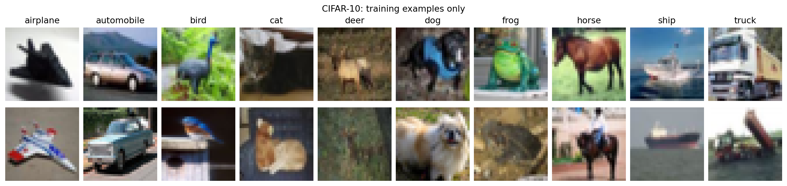
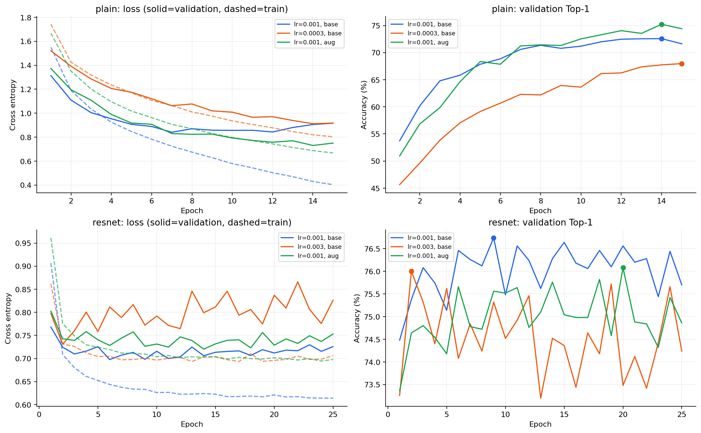
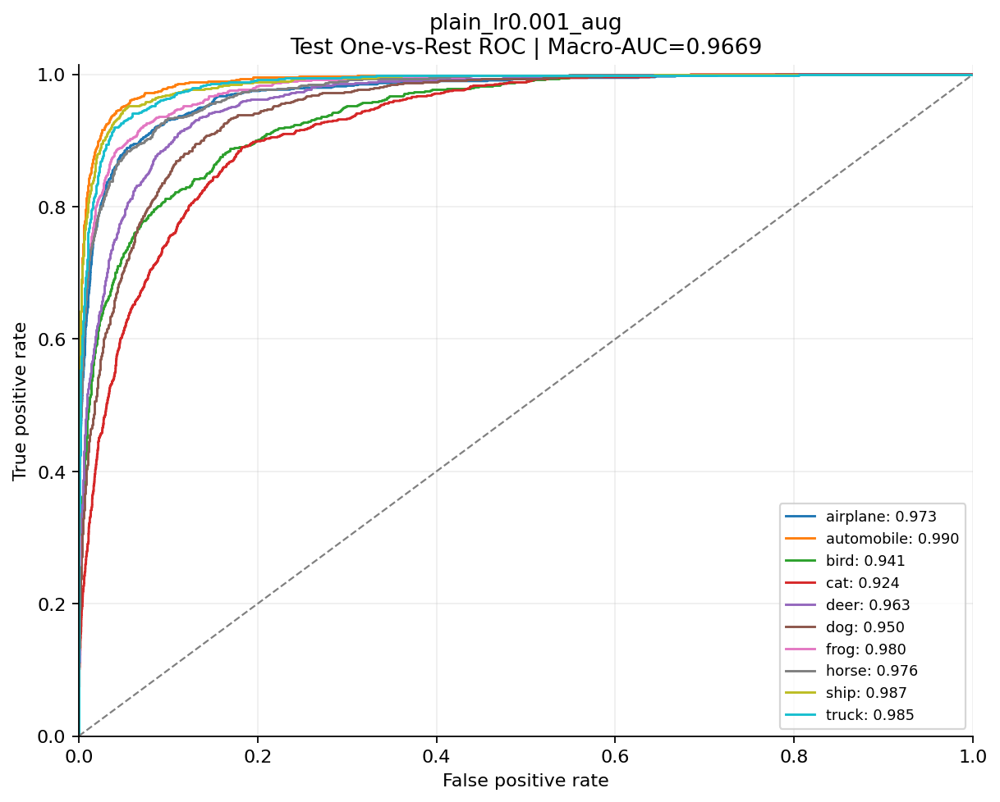
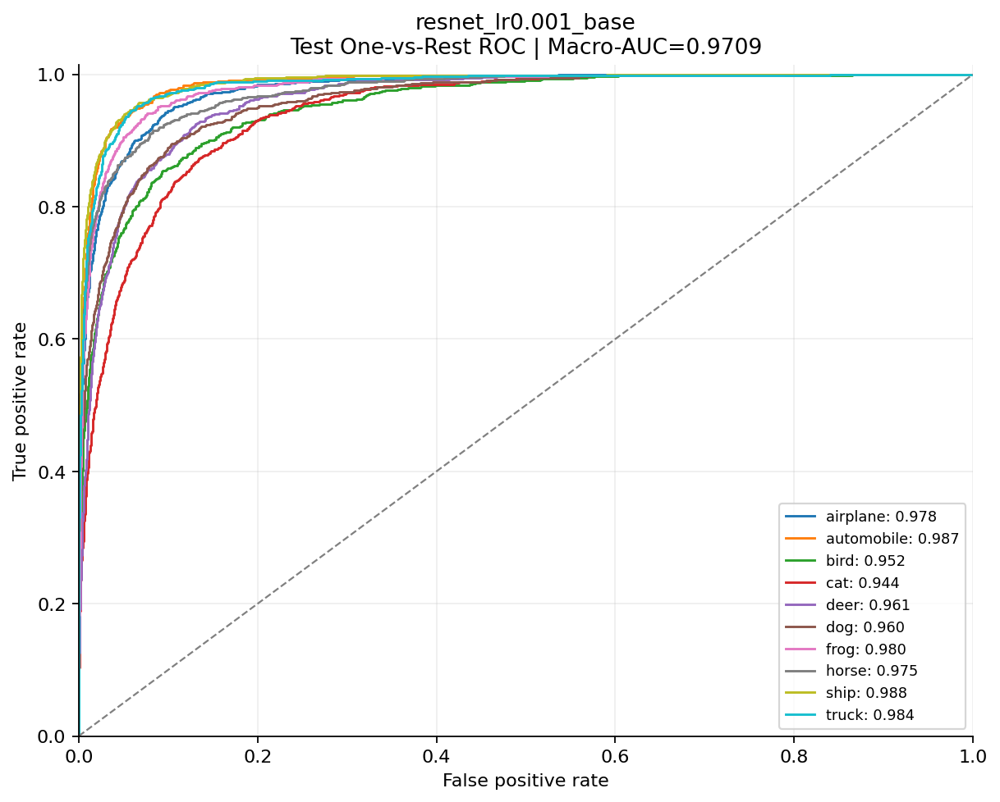
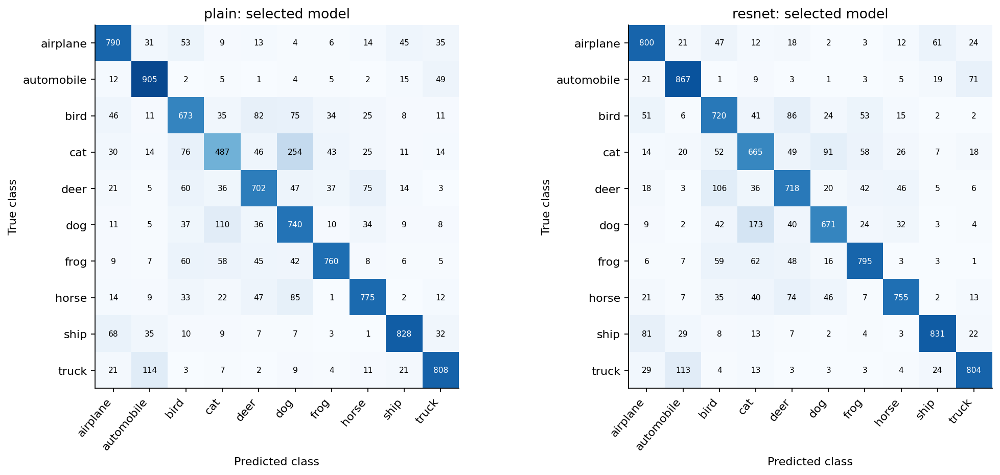
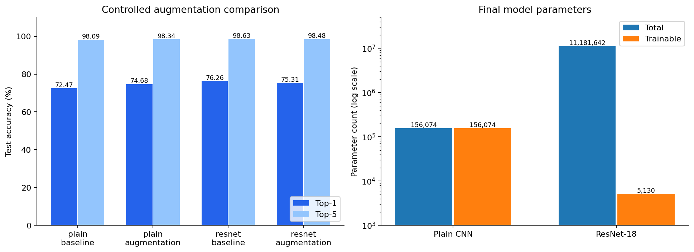
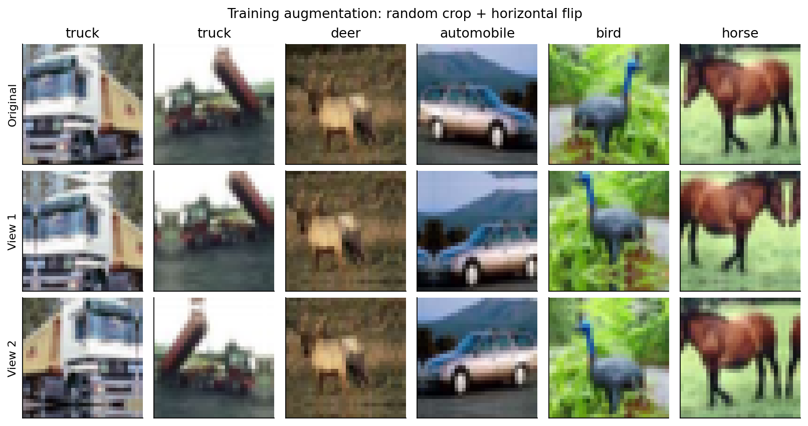
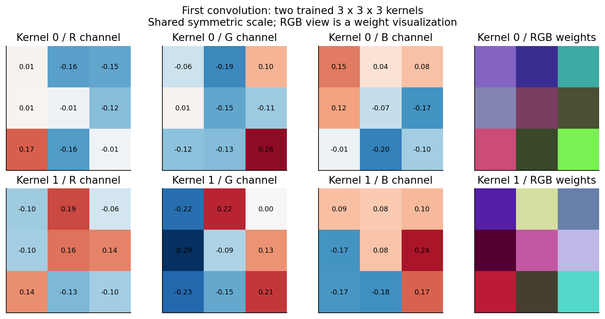
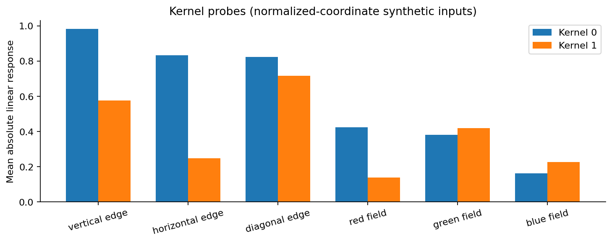
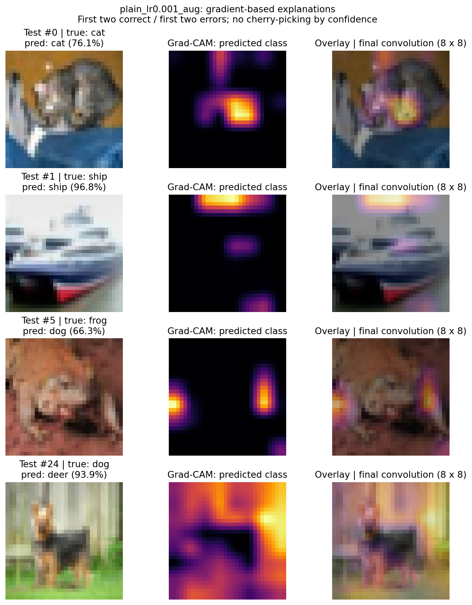

# MMIP Week 3：CNN 影像分類實驗報告

**蘇芯儀 / Sharon0726** · 課程：Multimodal Image Processing · 2026-09-23

本作業包含 Quiz 1–3 的全部基礎與進階項目。以下為 Google Colab **Tesla T4** 上實際執行的結果。程式、逐 epoch 紀錄、每張測試影像的預測機率及六份最佳驗證 checkpoint 一併提交。

最終模型由 validation Top-1 選出：

| 模型 | Validation Top-1 | Test Top-1 | Test Top-5 | Macro-AUC | Total / Trainable parameters |
| --- | --- | --- | --- | --- | --- |
| plain_lr0.001_aug | 75.24% | 74.68% | 98.34% | 0.9669 | 156,074 / 156,074 |
| resnet_lr0.001_base | 76.74% | 76.26% | 98.63% | 0.9709 | 11,181,642 / 5,130 |

## Quiz 1：準備資料集（15 分）

### 來源與分類任務

使用 [CIFAR-10 官方資料集](https://www.cs.toronto.edu/~kriz/cifar.html)（Krizhevsky, 2009），包含 60,000 張 32×32 RGB 影像、10 個互斥類別。官方分成 50,000 training images 與 10,000 test images，原始壓縮檔透過 TorchVision 下載並以其內建 checksum 驗證。

問題定義為 **single-label, 10-class image classification**：給定一張 RGB 影像，輸出 10 類 logits／softmax 機率，以最大分數的類別為 Top-1 預測。

| ID | Class | 繁體中文 |
|---|---|---|
| 0 | airplane | 飛機 |
| 1 | automobile | 汽車 |
| 2 | bird | 鳥 |
| 3 | cat | 貓 |
| 4 | deer | 鹿 |
| 5 | dog | 狗 |
| 6 | frog | 青蛙 |
| 7 | horse | 馬 |
| 8 | ship | 船 |
| 9 | truck | 卡車 |

### 固定切分與資料洩漏控制

對官方 50,000 張 training images 依類別分層，以 NumPy RNG seed **20260923** 打亂各類索引；每類取 4,500 train、500 validation。官方 test 完整保留。

| Split | 每類 | 總數 | 來源與用途 |
|---|---:|---:|---|
| Train | 4,500 | 45,000 | 官方 train；計算梯度與更新權重 |
| Validation | 500 | 5,000 | 官方 train；選 learning rate、epoch 與 baseline／augmentation |
| Test | 1,000 | 10,000 | 官方 test；決策鎖定後才做最終推論 |

使用全部 60,000 張影像；train／validation 沒有重複索引。test 的 index 屬於另一個官方檔案，因此數值相同不表示是同一張圖。`split_manifest.csv` 同時記錄 source 與 index，可完整稽核。採單次固定 validation split，未採可選的 K-Fold。所有實驗共用這組 split。

影像先轉為 [0,1]，再使用固定的 ImageNet mean=(0.485,0.456,0.406)、std=(0.229,0.224,0.225) 正規化；沒有由 validation／test 估計統計量。Plain CNN 保持 32×32；ResNet 用 bilinear、antialias=True 放大為 64×64。評估均為單一確定性視角，不做隨機擴增或 test-time augmentation。

## Quiz 2：訓練與比較（基礎 30＋進階 20 分）

### 自訂 Plain CNN

自行實作三個串接 block：`Conv3×3 → ReLU → MaxPool2×2`，通道為 3→16→32→64；padding=1，卷積含 bias。沒有 shortcut、residual 或預訓練權重。

| 階段 | 輸出尺寸 |
|---|---|
| Input | 3×32×32 |
| Block 1 | 16×16×16 |
| Block 2 | 32×8×8 |
| Block 3 | 64×4×4 |
| Flatten → Linear → ReLU | 128 |
| Linear | 10 logits |

### 經典 CNN：ResNet-18 Transfer Learning

採 [ResNet](https://arxiv.org/abs/1512.03385) 的 ResNet-18 與官方 `ResNet18_Weights.IMAGENET1K_V1`。凍結整個預訓練 Backbone，將 1,000-class FC 換成 `Linear(512,10)`；只訓練新的 head。Backbone 永遠保持 `eval()`，BatchNorm running statistics 也固定。

每張影像的 frozen feature 可預先計算；快取的是影像經完整 Backbone 後的 512 維向量。訓練線性 head 等價於凍結 Backbone 後訓練完整模型的 head，不是用未訓練模型代替 Transfer Learning。已驗證重新組合 Backbone＋head 的 end-to-end 機率與快取推論一致。

64×64 是本實驗控制計算量的設計，與權重官方預設的 224×224 評估流程不同；此報告不宣稱復現 ImageNet 官方數值。模型間也同時存在預訓練、解析度、深度等差異，因此不能把表現差異全歸因於 residual connection。

### 超參數實驗設計

兩個模型各比較兩種 learning rate，其他條件在各模型內固定。初始化 seed、每個 epoch 的 shuffle order、split、batch size、optimizer、weight decay 均固定。optimizer=AdamW，cross-entropy loss（直接輸入 logits），batch size=128，weight decay=0.0001；不使用 learning-rate scheduler、early stopping、label smoothing 或 Mixup。

| 模型 | Learning rates | Epochs／run | 訓練部分 |
|---|---|---:|---|
| Plain CNN | 0.001、0.0003 | 15 | 全部權重 |
| ResNet-18 | 0.001、0.003 | 25 | 新增的 512→10 head |

每次 run 保留 validation Top-1 最高的 epoch；同分取最早 epoch。先從兩個無擴增設定選 baseline，再以該 learning rate 加入擴增。最終在 baseline 與 augmentation 間依 validation 選擇；同分選 baseline。**所有決策寫入 `selection.json` 後，才首次對 test 做推論。** 六組 test 結果均報告，沒有利用 test 排名選模型。

| Run | Learning rate | Augmentation | Best epoch | Val Top-1 | Val Top-5 | Test Top-1 | Test Top-5 | Macro-AUC |
| --- | --- | --- | --- | --- | --- | --- | --- | --- |
| plain_lr0.001_base | 0.001 | False | 14/15 | 72.58% | 97.54% | 72.47% | 98.09% | 0.9607 |
| plain_lr0.0003_base | 0.0003 | False | 15/15 | 67.98% | 97.18% | 67.88% | 97.30% | 0.9486 |
| plain_lr0.001_aug | 0.001 | True | 14/15 | 75.24% | 98.18% | 74.68% | 98.34% | 0.9669 |
| resnet_lr0.001_base | 0.001 | False | 9/25 | 76.74% | 98.60% | 76.26% | 98.63% | 0.9709 |
| resnet_lr0.003_base | 0.003 | False | 2/25 | 76.00% | 98.28% | 75.55% | 98.61% | 0.9690 |
| resnet_lr0.001_aug | 0.001 | True | 20/25 | 76.08% | 98.42% | 75.31% | 98.48% | 0.9695 |

- **plain**：learning rate=0.001 的最佳 validation Top-1 為 72.58%，另一設定 0.0003 為 67.98%。因此採用前者進行擴增對照；這是固定預算下的 learning-rate 比較，不代表搜尋到全域最佳超參數。
- **resnet**：learning rate=0.001 的最佳 validation Top-1 為 76.74%，另一設定 0.003 為 76.00%。因此採用前者進行擴增對照；這是固定預算下的 learning-rate 比較，不代表搜尋到全域最佳超參數。

訓練曲線中的 train loss／Top-1 是各 batch 更新過程的加權平均，validation 則在 epoch 結束後以同一個 checkpoint 評估；兩者不是完全同時點的量測。曲線呈現收斂與過擬合跡象，但不作為額外調參回饋。

### Testing Dataset 預測與指標

每個 run 預測全部 10,000 張 official test images。`results/predictions/*.csv` 包含 test_index、true_class、predicted_class、Top-1／Top-5 是否命中、五個候選類別及 **10 類 softmax 機率**；另存 `.npz` 方便精確重算。不同模型的相同行對應同一張測試影像。

- Top-1 Accuracy：最高分的類別等於真實類別的比例。
- Top-5 Accuracy：真實類別出現在前五名的比例。本資料有 10 類，因此 Top-5 不會必然是 100%。
- ROC：每類各自做 One-vs-Rest，以該類 softmax score 排序，不能以 argmax label 取代。
- Macro-AUC：10 個 class-wise AUC 的算術平均；此處不是 micro 或 weighted AUC，也不是先畫平均 ROC 再積分。

| Class | Plain CNN AUC | ResNet-18 AUC |
| --- | --- | --- |
| airplane | 0.9732 | 0.9775 |
| automobile | 0.9901 | 0.9869 |
| bird | 0.9409 | 0.9519 |
| cat | 0.9237 | 0.9437 |
| deer | 0.9626 | 0.9615 |
| dog | 0.9500 | 0.9604 |
| frog | 0.9796 | 0.9799 |
| horse | 0.9761 | 0.9751 |
| ship | 0.9874 | 0.9878 |
| truck | 0.9852 | 0.9844 |

每個實驗都有 10 條 ROC，且 `results/roc/*.csv` 儲存 FPR、TPR 與 threshold。AUC 衡量類別分數的排序區分能力；Top-1 要求真實類別超過其他所有類別，兩者意義不同。

- **plain** 最多的三種錯誤（真實 → 預測）為：cat → dog：254 張；truck → automobile：114 張；dog → cat：110 張。
- **resnet** 最多的三種錯誤（真實 → 預測）為：dog → cat：173 張；truck → automobile：113 張；deer → bird：106 張。

### Accuracy 與參數量

Plain CNN 共 **156,074** 個參數，全部可訓練。ResNet-18 共 **11,181,642** 個參數，但只更新 **5,130** 個 head 參數。trainable parameters 少不代表推論模型小：ResNet 仍須儲存並執行完整 Backbone。

最終 test Top-1 差異為 ResNet 減 Plain **+1.58 pp**。這是兩個完整訓練方案的實測比較，並非只比較架構的嚴格消融。

## Quiz 3：泛化與可解釋性（基礎 15＋進階 20 分）

### Data Augmentation 前後比較

在原始 32×32 RGB 影像上，先 reflection padding 4 pixels，再各自隨機選擇 32×32 crop，並以 p=0.5 水平翻轉。避免垂直翻轉、過強旋轉或遮蔽，以減少破壞自然物件語意；類別標籤不變。

每張訓練影像產生 **兩個固定且獨立的擴增視角**（seed=20260924、20260925），交替用於不同 epochs。每個 epoch 仍只有 45,000 筆，各原圖出現一次，沒有以資料量或步數倍增造成不公平比較。這是有限視角擴增，不是每個 epoch 重新抽樣無限視角。Plain 與 ResNet 使用相同視角；後者在擴增後才放大為 64×64 並快取特徵。

baseline／augmentation 固定同一 learning rate、初始化 seed、batch order、optimizer、weight decay、epochs、split 與評估流程；唯一的輸入差異是訓練時是否使用擴增。最佳 epoch 仍使用相同的 validation 選模規則，因此兩者最佳 epoch 可能不同。

| 模型 | Baseline Top-1 | Augmented Top-1 | 差異 | Top-5 baseline → aug | Macro-AUC baseline → aug |
| --- | --- | --- | --- | --- | --- |
| plain | 72.47% | 74.68% | +2.21 pp | 98.09% → 98.34% | 0.9607 → 0.9669 |
| resnet | 76.26% | 75.31% | -0.95 pp | 98.63% → 98.48% | 0.9709 → 0.9695 |

- **plain**：test Top-1 提高 2.21 個百分點；validation Top-1 由 72.58% 變成 75.24%。最終依 validation 選用 `plain_lr0.001_aug`。測試差異只用於事後報告，沒有回頭調整策略。
- **resnet**：test Top-1 降低 0.95 個百分點；validation Top-1 由 76.74% 變成 76.08%。最終依 validation 選用 `resnet_lr0.001_base`。測試差異只用於事後報告，沒有回頭調整策略。

擴增讓模型見到不同位置與左右方向，但也可能裁掉重要線索。尤其 frozen ResNet 不能更新 Backbone 以適應擴增，只能由 head 調整決策。效果取決於模型、增強強度與訓練預算，不能預設一定提升。

### 兩個訓練後 Kernel 的視覺化

取最終 Plain CNN 第一層的 **output kernel 0 與 1**，以固定索引選取，避免事後挑選好看的圖。每個 Kernel 實際為 3×3×3；圖中分別顯示 R／G／B 通道的帶正負權重，以及共用對稱尺度的 RGB 合成視圖。合成色彩是權重顯示方式，不是原始影像或 Feature Map。

為使解讀有數值依據，額外輸入 vertical／horizontal／diagonal edge 與 R／G／B 單色探針，量測不含 bias、ReLU 的 convolution 平均絕對響應。探針採正規化座標，作用是比較局部權重偏好，不是自然影像分類測試。

- **Kernel 0**：三種等振幅邊緣探針中，`vertical edge` 的平均絕對線性響應最大（0.9819）；三種單色探針中，`red field` 響應最大（0.4237）。這支持它對該類局部亮暗／通道組合較敏感的解讀，但不能直接命名為某種物件偵測器。
- **Kernel 1**：三種等振幅邊緣探針中，`diagonal edge` 的平均絕對線性響應最大（0.7174）；三種單色探針中，`green field` 響應最大（0.4183）。這支持它對該類局部亮暗／通道組合較敏感的解讀，但不能直接命名為某種物件偵測器。

從帶符號權重看，Kernel 0 的 R 通道多數為負值，左下角為正，呈現通道抑制與局部對比的混合；因此「red field 絕對響應大」不等於「正向偵測紅色」。Kernel 1 的 G 通道左欄多為負、右側偏正，具有左右亮暗對比的線索；合併三通道後，控制探針顯示它對斜向邊緣的反應更強。此解讀同時參考實際權重與探針，不單憑合成顏色命名功能。

小尺寸 Kernel 可能混合邊緣、顏色與紋理訊號；不能只憑彩色方格就斷言它已學到「貓耳」或「車輪」。後續層才會組合這些低階特徵。

### XAI：Grad-CAM 與模型關注區域

對最終 Plain CNN 的最後一層 convolution `features[6]`（8×8 feature maps）實作 [Grad-CAM](https://arxiv.org/abs/1610.02391)：以 **predicted class 的 logit** 對 feature maps 求梯度，取空間平均作為 channel weights，加權後套 ReLU，再 bilinear 放大至 32×32。每張熱圖除以自己的最大值；不同樣本的顏色強度不能直接作絕對比較。

固定選取測試索引中最先出現的兩個正確案例與兩個錯誤案例，各組要求真實類別不同；未依 confidence 或熱圖好看程度挑選。

- **Test #0，cat → cat（76.14%）**：主要熱區在影像中央偏右的貓身體附近，另有上緣小塊熱區；模型並非只關注左側的臉部。遮蔽高熱區後 cat 機率下降 0.5114，但遮蔽低熱區也下降 0.5633，說明熱圖只涵蓋部分有效線索。
- **Test #1，ship → ship（96.85%）**：最亮區域位於船隻上方的淺色背景，船體中央僅有次要熱區。遮蔽低熱區的機率降幅 0.9198，遠高於高熱區的 0.1527；因此這張 Grad-CAM 的空間排序並未忠實涵蓋所有重要證據，不能據此宣稱模型準確定位船體。
- **Test #5，frog → dog（66.30%）**：熱區集中在左側邊緣及右側局部，中央可見的青蛙輪廓反而不明顯。這與模型可能利用局部褐色紋理或背景線索的假設一致，但不足以證明誤判原因；高、低熱區遮蔽都明顯降低 dog 機率。
- **Test #24，dog → deer（93.89%）**：高熱度大範圍分布在上方與右側背景，中央較深的狗身體呈低熱度。模型即使信心很高仍然答錯。高熱區遮蔽只降低 0.0442，低熱區遮蔽反而提高約 0.0295；此結果提示背景捷徑與局部解釋侷限，不能把熱度直接當成可靠的物件證據。

四個案例中，前三個的低熱區遮蔽都比高熱區造成更大的機率下降。這是一項不支持「高熱度必然更重要」的實測結果；本作業保留這些案例，而沒有更換成較漂亮的熱圖。

為輔助檢查熱圖，分別將最高／最低熱度的 25% pixels 以 ImageNet channel means 取代，重新量測 predicted-class probability。Δp=原始機率−遮蔽後機率；正值代表遮蔽使該預測的支持下降，負值代表遮蔽反而提升。

| Test index | True → Predicted | Confidence | 遮蔽高熱區 Δp | 遮蔽低熱區 Δp |
| --- | --- | --- | --- | --- |
| 0 | cat → cat | 76.14% | +0.5114 | +0.5633 |
| 1 | ship → ship | 96.85% | +0.1527 | +0.9198 |
| 5 | frog → dog | 66.30% | +0.4243 | +0.4950 |
| 24 | dog → deer | 93.89% | +0.0442 | -0.0295 |

這是局部擾動診斷；分散像素遮蔽也可能產生 out-of-distribution 圖樣，不能視為物件區域的因果證明。Grad-CAM 的解析度只有 8×8，也不等同 segmentation mask。錯誤預測的熱圖解釋的是模型所預測的類別，並非保證指出真實物件。

## 重現與限制

- 平台：Google Colab，GPU=Tesla T4；Python=3.13.15，PyTorch=2.11.0+cu130，TorchVision=0.26.0+cu130。
- NumPy=2.1.3，scikit-learn=1.6.1。完整設定與時間戳記見 `results/environment.json`。
- 設定 deterministic algorithms 與固定 seed；CUDA／CPU、程式庫版本或硬體不同時，仍可能有浮點數差異，不保證跨平台 bitwise identical。
- 凍結 Backbone 的預訓練權重 SHA-256：`f37072fd47e89c5e827621c5baffa7500819f7896bbacec160b1a16c560e07ec`。
- 只使用一個 split、一次 seed、兩種 learning rates；沒有多 seed 信賴區間，因此不能據此宣稱某方法普遍優越。
- 只比較 frozen ResNet head，未做 full fine-tuning；64×64 輸入與有限的兩個 augmentation views 都是本實驗的範圍限制。
- 已以 `verify_results.py` 獨立重算 60,000 列預測的 Top-1／Top-5／Macro-AUC、驗證 split 不重疊、最佳 epoch、參數量、checkpoint 重載與熱圖。實際狀態見 `results/verification.json`。
- PDF 與原始 `md檔/` 不上傳；此報告與新 Notebook 為本次作業產出。使用 Codex 協助程式實作與文件整理；所有報告數值均來自上述實際執行結果。

## 參考來源

1. 鄭中嘉（Eric），MMIP Week 03：CNN，2026-09-23，第 79–81 頁作業要求（本機提供的三份 Markdown 與教材）。
2. Krizhevsky (2009), *Learning Multiple Layers of Features from Tiny Images*，[CIFAR 官方頁](https://www.cs.toronto.edu/~kriz/cifar.html)。
3. He et al., *Deep Residual Learning for Image Recognition*，[論文](https://arxiv.org/abs/1512.03385)。
4. [TorchVision ResNet-18 官方文件](https://docs.pytorch.org/vision/0.21/models/generated/torchvision.models.resnet18.html)。
5. Selvaraju et al., *Grad-CAM: Visual Explanations from Deep Networks via Gradient-based Localization*，[論文](https://arxiv.org/abs/1610.02391)。
