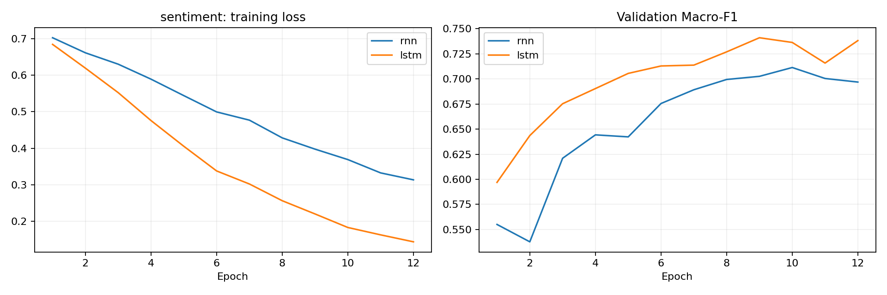
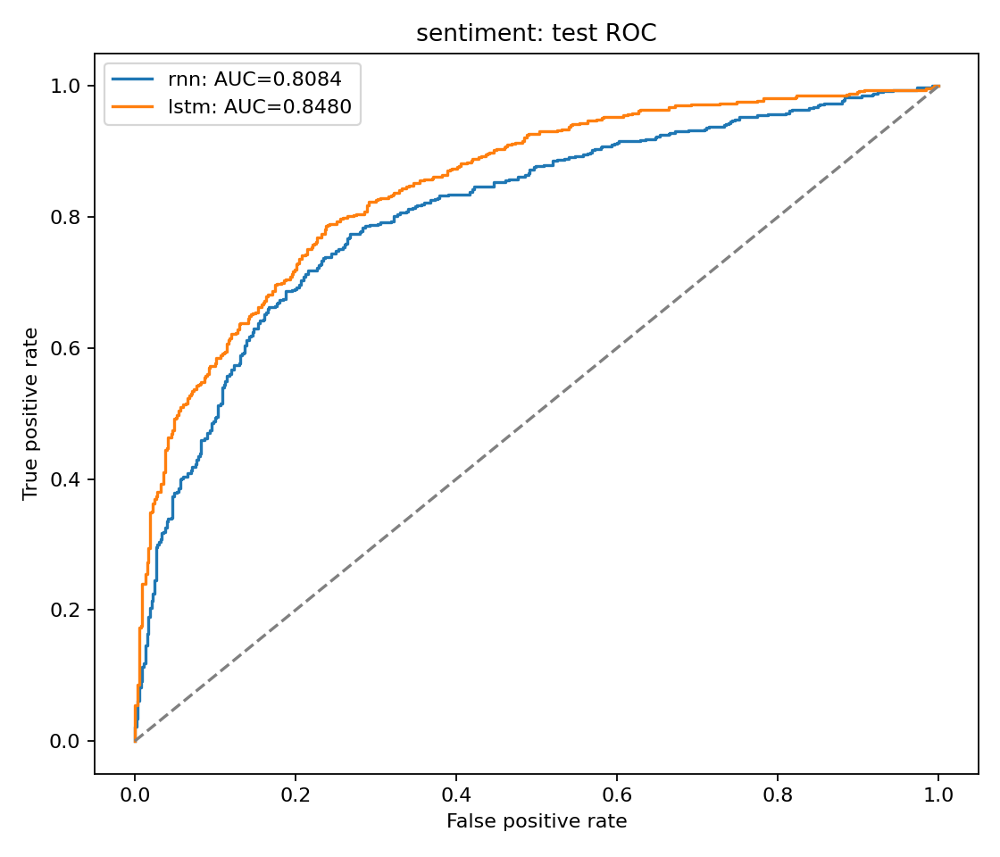
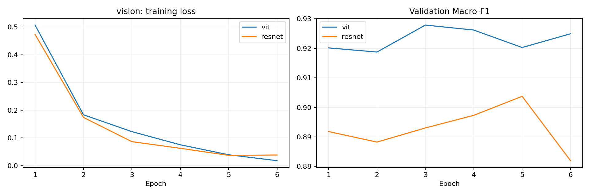
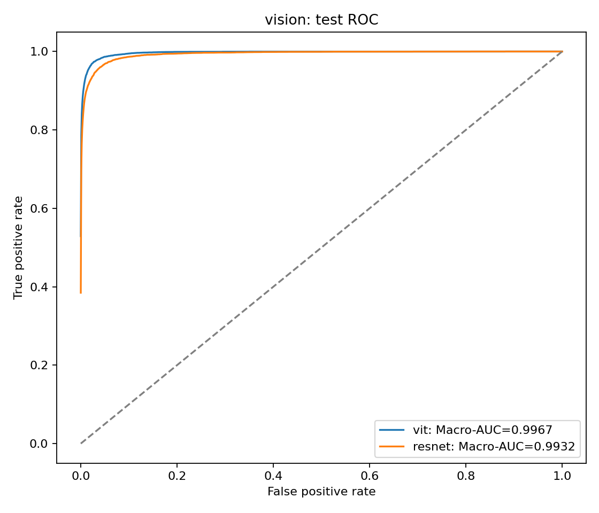
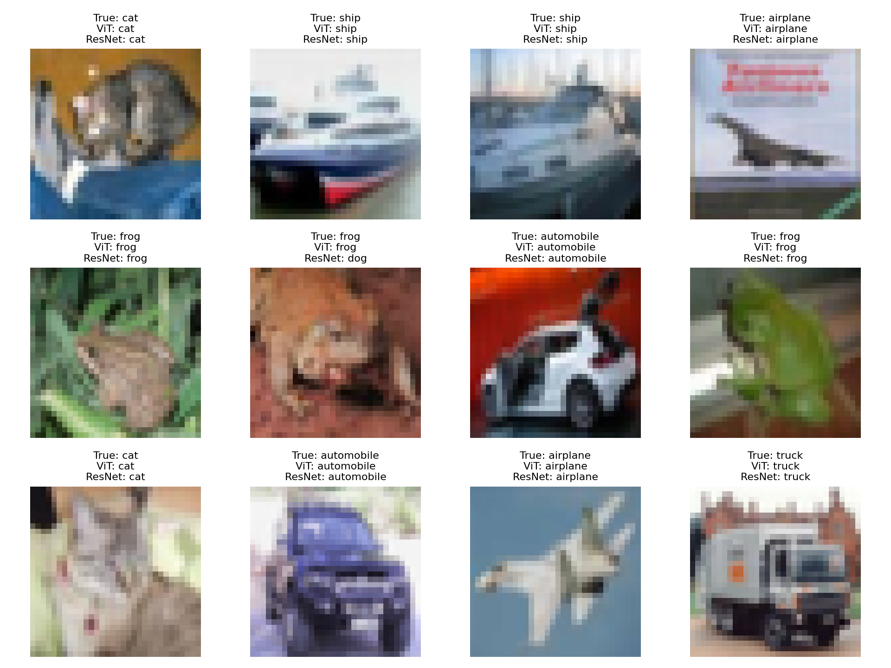
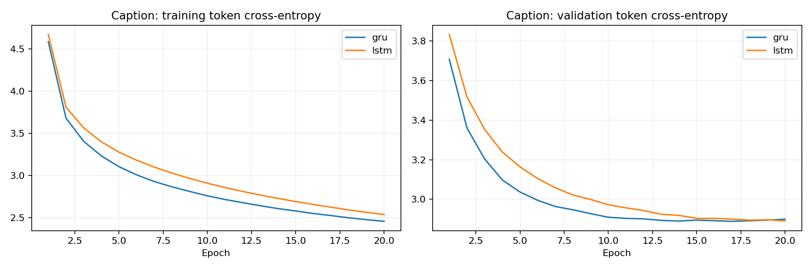
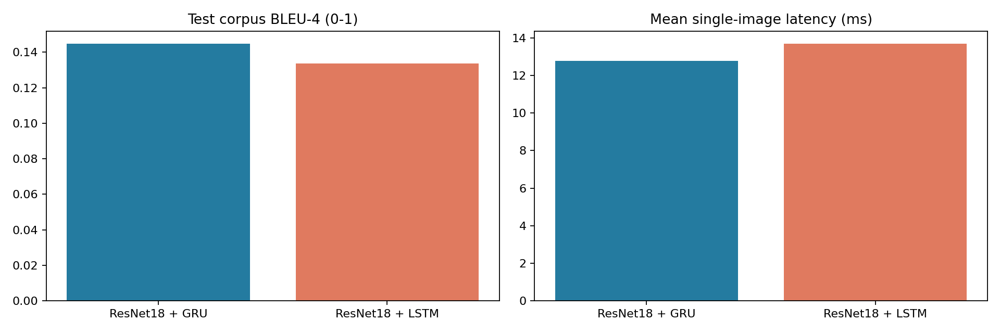
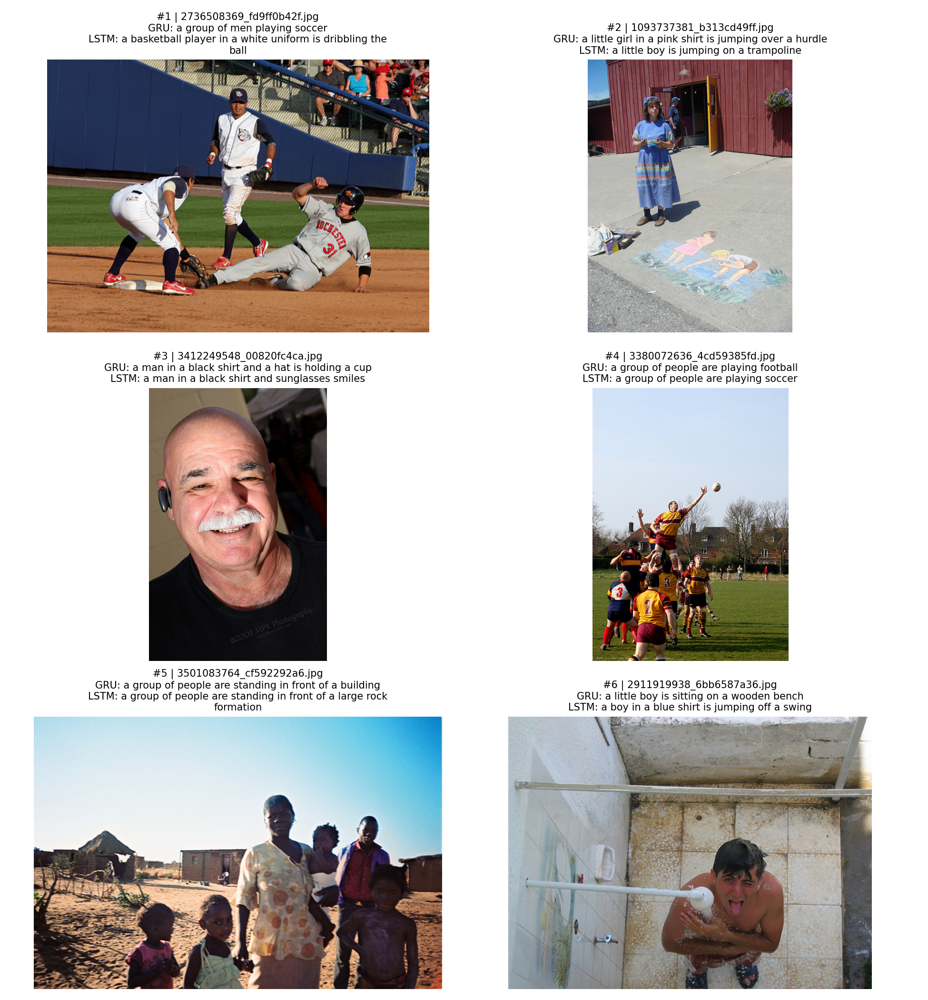

# MMIP Week 4：四題實驗報告

**蘇芯儀 / Sharon0726** · 課程：2026-09-30 · 實驗：2026-10-12

本報告數值由真實訓練後的測試預測重新計算。運算裝置：**Tesla T4**，PyTorch 2.11.0+cu130。完整環境、原始紀錄及來源雜湊位於 `results/`。

## Quiz 1：資料集準備（10 分）

| 任務 | train | validation | test | 輸入與標籤 |
|---|---:|---:|---:|---|
| Sentiment Analysis | 8530 | 1066 | 1066 | 英文影評，0 負面／1 正面 |
| Image Classification | 10000 | 2000 | 10000 | CIFAR-10 RGB 圖片，10 類 |
| Image Captioning | 6000 | 1000 | 1091 | Flickr8k 圖片，各有多個英文參考描述 |

### 來源與切分

1. **Rotten Tomatoes**：採 Hugging Face Cornell 封裝的官方 train/validation/test；以小寫與空白正規化後的文字 SHA-256 去除完全相同的句子，優先保留 test，再保留 validation。這不等同語意去重。字典只由訓練集建立，最大長度 64，未知字為 `<unk>`，不足補 `<pad>`。
2. **CIFAR-10**：從官方 50,000 張 train，以 seed=42 每類抽 1,000 張訓練與互斥的 200 張驗證；其餘 38000 張未使用。完整官方 10,000 張 test 都參與評估。影像調為 224×224；訓練隨機左右翻轉，驗證與測試不使用隨機增強。
3. **Flickr8k**：採 `tsystems/flickr8k`，共 8091 張。先按影像 ID 切分，再展開每張的參考描述，因此同一張照片的不同句子不會跨集合。train 有 30000 組影像描述。這是自訂切分，並非官方標準切分。字典僅使用訓練描述，共 6000 個詞元，序列最長 32（含 BOS/EOS）。

切分原始 ID、類別或檔名見 `results/sentiment_split.csv`、`vision_split.csv`、`caption_split.csv`。來源連結與授權說明見 [README](README.md#資料來源與限制)。

## Quiz 2：Sentiment Analysis（20 分）

### 模型與訓練

兩模型均為 128 維 Embedding → 單向、單層 128 hidden recurrent layer → dropout 0.3 → 二元分類。RNN 使用 tanh；LSTM 以輸入／遺忘／輸出閘控制記憶。取每句最後一個有效詞的 hidden state，避免 padding 污染分類位置。無預訓練詞向量。

相同 seed=42、train/val/test、batch=64、Adam lr=0.001、12 epochs、cross-entropy、gradient norm clipping=1。用 **validation Macro-F1** 最高的 checkpoint，然後一次評估 test。不同單元的參數量不完全相同，表中揭露。

| model   |   best_epoch |   parameters |   accuracy |   macro_precision |   macro_recall |   macro_f1 |    auc |   train_seconds |
|:--------|-------------:|-------------:|-----------:|------------------:|---------------:|-----------:|-------:|----------------:|
| rnn     |           10 |      1569282 |     0.7477 |            0.7519 |         0.7477 |     0.7466 | 0.8084 |          8.3522 |
| lstm    |            9 |      1668354 |     0.7702 |            0.7702 |         0.7702 |     0.7702 | 0.8480 |          7.8585 |

此實驗以 Macro-F1 比較，**LSTM** 較高（0.7702）。AUC 使用正面類別的連續預測機率，不使用硬標籤。結果來自單次訓練，未估計多種子的變異，不能保證每次 LSTM 都比 RNN 好。

### 測試推論

下表固定取 test 前八筆；0=negative，1=positive。完整預測與每類機率位於 `results/predictions/sentiment_*.csv`。

|   id | text                                                                                                                                                      |   true |   predicted |    p_1 |
|-----:|:----------------------------------------------------------------------------------------------------------------------------------------------------------|-------:|------------:|-------:|
|    0 | lovingly photographed in the manner of a golden book sprung to life , stuart little 2 manages sweetness largely without stickiness .                      |      1 |           0 | 0.0260 |
|    1 | consistently clever and suspenseful .                                                                                                                     |      1 |           1 | 0.8822 |
|    2 | it's like a " big chill " reunion of the baader-meinhof gang , only these guys are more harmless pranksters than political activists .                    |      1 |           0 | 0.4728 |
|    3 | the story gives ample opportunity for large-scale action and suspense , which director shekhar kapur supplies with tremendous skill .                     |      1 |           0 | 0.0407 |
|    4 | red dragon " never cuts corners .                                                                                                                         |      1 |           1 | 0.8064 |
|    5 | fresnadillo has something serious to say about the ways in which extravagant chance can distort our perspective and throw us off the path of good sense . |      1 |           1 | 0.9719 |
|    6 | throws in enough clever and unexpected twists to make the formula feel fresh .                                                                            |      1 |           1 | 0.9934 |
|    7 | weighty and ponderous but every bit as filling as the treat of the title .                                                                                |      1 |           1 | 0.9635 |

## Quiz 3：Vision Transformer（35 分）

### 實際微調範圍

- **ViT-Tiny / patch16 / 224**：ImageNet-21k 預訓練再經 ImageNet-1k 微調的權重；更新最後一個 Transformer block、最後 LayerNorm 與新的十類分類層。
- **ResNet18**：ImageNet-1k 權重；更新 layer4 及新的十類分類層。其餘層與 frozen BatchNorm 統計固定。

兩者的可訓練 backbone 都有更新（`backbone_max_abs_change > 0`），是部分 backbone 微調。共用 10,000 train、2,000 val、10,000 test；AdamW lr=0.0003、weight decay=0.01、batch=64、6 epochs，以 validation accuracy 選最佳 epoch。不同模型使用對應預訓練 normalization。GPU 使用自動混合精度。

| model   |   best_epoch |   trainable_parameters |   accuracy |   macro_f1 |    auc |   train_seconds |   backbone_max_abs_change |
|:--------|-------------:|-----------------------:|-----------:|-----------:|-------:|----------------:|--------------------------:|
| vit     |            3 |                 447178 |     0.9260 |     0.9260 | 0.9967 |        150.2742 |                    0.0411 |
| resnet  |            5 |                8398858 |     0.8949 |     0.8949 | 0.9932 |        148.5132 |                    0.0368 |

Macro-AUC 定義：對十個類別分別做 one-vs-rest ROC-AUC，再取等權平均。**vit** 的 Macro-AUC 較高（0.9967）。注意兩個模型的預訓練資料規模不同、可訓練參數量不同；此結果比較整體設定，不能把差異完全歸因於 Transformer 或 CNN 架構。

## Quiz 4：Image Captioning（35 分）

### 模型訓練與描述生成

ImageNet 預訓練 ResNet18 移除分類層，固定 encoder，抽取 512 維影像特徵。可訓練投影把影像特徵轉成 decoder 初始 hidden state；LSTM 另有 cell state 投影。比較單層 GRU 與 LSTM，皆為 256 維 embedding、256 hidden、dropout=0.3。encoder 固定，但 decoder 及影像投影確實以 Flickr8k 訓練。

訓練使用 teacher forcing：輸入 BOS 與前一個真實詞，預測下一詞。Cross-entropy 忽略 PAD；Adam lr=0.001、batch=128、20 epochs、gradient norm clipping=1，以 validation 每詞 loss 選 checkpoint。測試為 autoregressive greedy decoding，從 BOS 開始，不使用 test 參考句作輸入，遇 EOS 或長度上限停止。

### BLEU 與回覆時間比較

| model           |   best_epoch |   decoder_parameters |   bleu1 |   bleu4 |   mean_ms |   median_ms |   p95_ms |   train_seconds |
|:----------------|-------------:|---------------------:|--------:|--------:|----------:|------------:|---------:|----------------:|
| ResNet18 + GRU  |           17 |              3604080 |  0.5373 |  0.1446 |   12.7872 |     12.3161 |  17.9133 |         96.4057 |
| ResNet18 + LSTM |           20 |              3866992 |  0.5081 |  0.1336 |   13.6837 |     12.7226 |  22.8162 |        101.1058 |

BLEU 使用 NLTK corpus BLEU，對 **1091 張 test 影像**與各自全部參考句計算。轉小寫後用同一 regex tokenizer；BLEU-1 權重 (1,0,0,0)、BLEU-4 權重 (0.25,0.25,0.25,0.25)，含 brevity penalty，不做 smoothing，值域 0–1。BLEU 衡量詞序重疊，對合理同義句可能低估，因此另用 Gemini 做影像語意抽查。

計時使用同一 GPU、同一組固定前 100 張 test、batch=1。每個方法先暖機 3 張；每筆計時前後同步 CUDA。時間包含 resize/normalize、CPU→GPU、encoder 與完整 decoder，排除磁碟讀圖、模型下載、權重載入、網路及 Gemini 回覆。圖像已在記憶體，但影像特徵在每次計時中重新計算，並非直接使用快取特徵。計時原始樣本見 `caption_latency_*.csv`。

此設定下 **ResNet18 + GRU** 的 BLEU-4 較高（0.1446）；**ResNet18 + GRU** 的平均回覆時間較短（12.79 ms）。模型生成句長可能影響延遲，`caption_metrics.csv` 另附平均詞數。這是一次 100 張順序量測，未重複多輪；小幅速度差異不應解讀為穩定優勢。

### Gemini 判斷描述與影像是否相符

評審日期：2026-10-12。使用 **Google Gemini 網頁版 Flash 模式**；介面未顯示底層模型版本，因此不另推定版本。已實際上傳固定 test 前六張圖片與兩個模型的生成句，沒有提供參考描述。奇數案例 A=GRU、B=LSTM；偶數案例相反，提示中不揭露模型身分。

下表判定及理由保留 Gemini 原意，只移除網頁的 `JPG` 引用按鈕文字；另外加上對照模型與原始 caption。未修改任何不符合結果。

|   case | candidate   | model   | caption                                                           | verdict   | reason                                                                                                              |
|-------:|:------------|:--------|:------------------------------------------------------------------|:----------|:--------------------------------------------------------------------------------------------------------------------|
|      1 | A           | gru     | a group of men playing soccer                                     | 不符合    | 畫面中是一群穿著棒球服的男子在棒球場進行滑壘與守備，並非在踢足球（playing soccer）。                                |
|      1 | B           | lstm    | a basketball player in a white uniform is dribbling the ball      | 不符合    | 畫面中為棒球比賽的滑壘場景，既非籃球選手（basketball player），也沒有運球（dribbling the ball）的動作。             |
|      2 | A           | lstm    | a little boy is jumping on a trampoline                           | 不符合    | 圖片主要主體為一名站立的成年女性以及地上的粉筆畫，完全沒有小男孩在彈跳床跳躍（jumping on a trampoline）的實體場景。 |
|      2 | B           | gru     | a little girl in a pink shirt is jumping over a hurdle            | 不符合    | 地面彩繪雖繪有粉色衣著的小孩，但並非真實小女孩，亦無跨欄（jumping over a hurdle）的動作或設施。                     |
|      3 | A           | gru     | a man in a black shirt and a hat is holding a cup                 | 部分符合  | 圖片支持光頭男子身穿黑衣且帶有微笑，但他並未配戴帽子（hat）亦無手持杯子（holding a cup）。                          |
|      3 | B           | lstm    | a man in a black shirt and sunglasses smiles                      | 部分符合  | 圖片支持該名身穿黑衣的男子正面微笑，但他配戴的是耳掛式耳機而非太陽眼鏡（sunglasses）。                              |
|      4 | A           | lstm    | a group of people are playing soccer                              | 不符合    | 畫面呈現的是英式橄欖球（rugby）爭球或拋球場景，並非進行英式足球（playing soccer）運動。                             |
|      4 | B           | gru     | a group of people are playing football                            | 符合      | 畫面中一群男子正在草地上進行橄欖球（football/rugby）比賽，主要人物、數量、運動情境與空間關係皆能由圖片支持。        |
|      5 | A           | gru     | a group of people are standing in front of a building             | 符合      | 圖片支持畫面中央與右側有一群人（婦女與孩童）站立於戶外，背景確實為平房建物（building）。                            |
|      5 | B           | lstm    | a group of people are standing in front of a large rock formation | 不符合    | 畫面支持有一群人站立在沙地上，但背景為數間磚瓦平房與茅草屋，並不存在大型岩石地形（large rock formation）。          |
|      6 | A           | lstm    | a boy in a blue shirt is jumping off a swing                      | 不符合    | 畫面為一名赤膊青年在室外蓮蓬頭下沖水淋浴，既非身穿藍衣，也沒有從鞦韆上跳下（jumping off a swing）。                 |
|      6 | B           | gru     | a little boy is sitting on a wooden bench                         | 不符合    | 主體為一名站立仰頭沖澡的青年，並非坐在木質長椅（sitting on a wooden bench）上的小男孩。                             |

抽樣判定筆數（每模型 6 筆）：

| model   |   符合 |   部分符合 |   不符合 |
|:--------|-------:|-----------:|---------:|
| gru     |      2 |          1 |        3 |
| lstm    |      0 |          1 |        5 |

GRU 在這六張中有兩筆「符合」，LSTM 沒有完整符合案例；兩者各有一筆「部分符合」。這與本次 GRU 的 BLEU-4 較高方向一致，但 **六張質性抽樣不能估計全測試集準確率，也不足以證明架構優劣**。兩個模型都有把棒球、淋浴等核心事件說錯的案例，顯示能生成流暢句子不代表影像語意正確。

**評審歧義與限制：** 案例 4 的圖片是 rugby。Gemini 將 GRU 的 `football` 視為涵蓋 rugby 而判「符合」；若把 `football` 狹義解讀為美式足球或 association football，評價可能較低。因此保留原判定，同時指出此處有語詞歧義。模型與 Gemini 的細節判斷都可能出錯，不能以評審文字取代圖片證據。

查核檔案位於 `results/gemini_review/`：`prompt.txt` 為送出的提示；`raw_response.txt` 為可見回覆的原始文字（含網頁引用標籤）；`raw_rows.json` 保存原始表格欄位；`review.csv` 是 A/B 映射後的表格；`metadata.json` 記錄模式及原對話；`gemini_review_start.png` 與 `gemini_review.png` 保存網頁畫面。六張原圖與生成描述見上方例圖及 `results/gemini_cases.json`。

## 查核與重現

`verify_results.py` 獨立從逐筆預測重算 Accuracy、Macro-F1、Precision、Recall、ROC-AUC 與 corpus BLEU，確認兩模型使用相同 test IDs、機率和為 1、各集合互斥、生成文字非空，以及微調的 backbone 權重實際改變。檢查狀態：**True**。

完整參數見 `config.json`；重現入口：[Colab Runner](MMIP_Week4_Colab.ipynb)。CPU 不需要負擔本次 GPU 訓練。權重保留於本機與 Colab 匯出壓縮檔，大型資料與權重不放 GitHub。不同硬體或套件版本可能有浮點數差異。

## 作業要求對照

| 項目 | 分數 | 證據 |
|---|---:|---|
| 三種資料集準備 | 10 | Quiz 1，來源、切分清單、字典及例圖 |
| RNN 訓練與 test 推論 | 10 | Quiz 2，訓練紀錄、逐筆機率 |
| LSTM 訓練與 RNN 比較 | 10 | Quiz 2，Macro-F1、AUC、曲線 |
| ViT 微調與推論 | 20 | Quiz 3，實際 backbone 更新、test 圖與機率 |
| ResNet 微調與 Macro-AUC 比較 | 15 | Quiz 3，完整 10,000 張 test |
| Caption 模型訓練與生成 | 15 | Quiz 4，兩種 decoder、test 描述 |
| Gemini 影像與描述相符性判斷 | 5 | 保存的 Gemini 提示、原始回覆及截圖 |
| BLEU 量化 | 5 | 全部 caption test、多參考 corpus BLEU |
| 方法間回覆時間與表現比較 | 10 | GRU/LSTM 的 100 筆計時、BLEU 與分析 |

## 限制與改善方向

小型 decoder、固定 encoder 與 greedy decoding 容易生成常見句型，對人物數量、顏色、動作及空間關係可能錯誤。BLEU 和 Gemini 都不是人類標準答案；Gemini 抽查僅六張影像，不能外推成全測試集準確率。可再比較 attention decoder、beam search、BLIP 微調與多種子實驗，但這些不屬於本次已執行結果。
